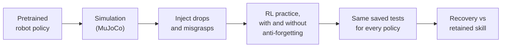

# Afterslip

**Recover without forgetting.** Teaching a robot arm to recover when it drops something, without losing the skills it already has.


<sub>Illustration of the idea, not a result.</sub>

## What is this?

Robot arms can learn a task by **copying human demonstrations** (imitation learning). They break down when something unexpected happens, like an object slipping out of the gripper, because no demonstration ever showed what to do next.

Afterslip takes such a pretrained robot policy and lets it **practise recovering from slips** in simulation, using reinforcement learning (RL). The catch: practising a new skill can erode the old one. Afterslip measures that trade-off and tests ways to keep both.

> **The question:** can RL teach a robot to recover from drops *without forgetting* how to do its original job? And which technique preserves the original skill best?

## How it works



<sub>Planned behaviour, not results. The comparison may come out positive, negative or inconclusive, and every outcome is reported. "Same saved tests" is the primary disturbed evaluation, where every policy starts from identical saved disturbed states; a separate suite also injects disturbances online during each policy's own run. Components, data flow and the fair-test protocol: [docs/architecture.md](docs/architecture.md).</sub>

1. **Start** from a pretrained *flow-matching* manipulation policy that uses simulator state (no camera), e.g. one that picks up a can and places it in a bin. Which policy is used is decided after artifact, license and reproduction checks.
2. **Disturb** it: force drops and misgrasps in simulation.
3. **Fine-tune** it with online RL (ReinFlow) so recoveries are rewarded.
4. **Protect** the old skill with one of three techniques: a leash to the original policy, frozen layers, or rehearsing old demos.
5. **Measure** every variant on the *same* saved set of disturbances (primary suite), plus disturbances injected during its own run (secondary suite): how often it recovers, and how much of its original success it keeps.

Everything is **pure simulation** in [MuJoCo](https://mujoco.org). No robot hardware is needed.

The research question is to be answered first on a standard benchmark: a Franka Panda picking a can (robosuite / Robomimic). This benchmark and a state-based pretrained policy for it are **candidates**: they are adopted only if the policy and its data pass the artifact, license and reproduction checks of milestone M0; otherwise the policy is pretrained here, or the scope is reviewed. Alongside it, an **FR3 track** brings in the Franka Research 3 arm: first step-by-step learning exercises, each with a video, then, after the core results exist, the three-bin sorting scene from the explainer. How the FR3 base policy is obtained, and whether that phase is a demonstration or a full research comparison, are decided by a feasibility review first.

## Where to start

| If you have… | Read |
|---|---|
| 3 minutes | [docs/explainer.md](docs/explainer.md): the illustrated story |
| 20 minutes | [docs/requirements.md](docs/requirements.md) §1 Purpose, §3 Scope, §10 Milestones |
| Time to build | [docs/requirements.md](docs/requirements.md) in full: numbered requirements, metrics, experiments |
| The system's big picture | [docs/architecture.md](docs/architecture.md): components, data flow, evaluation sequence, FR3 track |
| Planning the work | [docs/plan.md](docs/plan.md) roadmap → [docs/milestones.md](docs/milestones.md) work items → [docs/test-plan.md](docs/test-plan.md) checks |
| Setting up | [docs/setup.md](docs/setup.md): platforms, stack, versions, package management |

## Status

**Early M0.** The first milestone is **M0 Verify**: confirm the pretrained checkpoints and datasets, their licenses, and a CPU smoke test. See requirements §10 and [docs/milestones.md](docs/milestones.md). What exists so far:

- a locked environment (`make setup`) validated on macOS Apple Silicon; the Linux lock exists but has **not yet been validated** on Linux
- simulation smoke tests (`make smoke`)
- a code skeleton for the task interface and the observer recorder, with integration tests that define the first increment; its implementation is **not yet done**, so those tests are marked as strict expected failures (they report as `xfailed`, which is not evidence that the code works)
- no pretrained policy has been loaded or verified yet

## Proposed stack

Python · MuJoCo · robosuite / Robomimic tasks · ReinFlow (flow-policy RL fine-tuning). The code should run on CPU, CUDA or Apple Silicon, with the device chosen by config. These choices are confirmed or replaced at M0.

## Repository layout

```
README.md            you are here
LICENSE              MIT
Makefile             setup, lock and test commands (make help)
pyproject.toml       package metadata and tool settings
environment.yml      conda layer input (Python, pip)
requirements.in      Python dependencies (input)
requirements-overrides.txt   corrections to dependency metadata (input)
conda-lock.yml, requirements-*.lock   generated lock files (make lock)
afterslip/           the Python package: task interface, recorder (skeleton)
docs/
  explainer.md       the story, with animations
  explainer/         animated SVGs + make_svgs.py (regenerates them)
  requirements.md    what to build: requirements, metrics, milestones
  architecture.md    system big picture: components and flows (diagrams)
  design.md          technical design: interfaces and decisions
  plan.md            one-page roadmap
  milestones.md      work items, decision points and checks per milestone
  test-plan.md       how each check is verified
  setup.md           environment, stack, versions, package management
tests/               smoke and integration tests
outputs/             generated local results (git-ignored)
```

## License

[MIT](LICENSE). Third-party models, checkpoints and datasets keep their own licenses; record each one in `ARTIFACTS.md` before use (requirements FR-ART-02).
