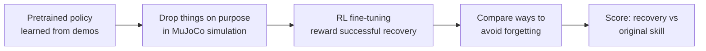

# Afterslip

**Recover without forgetting.** Teaching a robot arm to recover when it drops something, without losing the skills it already has.



<sub>Illustration of the idea, not a result.</sub>

## What is this?

Robot arms can learn a task by **copying human demonstrations** (imitation learning). They break down when something unexpected happens, like an object slipping out of the gripper, because no demonstration ever showed what to do next.

Afterslip takes such a pretrained robot policy and lets it **practise recovering from slips** in simulation, using reinforcement learning (RL). The catch: practising a new skill can erode the old one. Afterslip measures that trade-off and tests ways to keep both.

> **The question:** can RL teach a robot to recover from drops *without forgetting* how to do its original job? And which technique preserves the original skill best?

## How it works



1. **Start** from a pretrained *flow-matching* manipulation policy, e.g. one that picks up a can and places it in a bin.
2. **Disturb** it: force drops and misgrasps in simulation.
3. **Fine-tune** it with online RL (ReinFlow) so recoveries are rewarded.
4. **Protect** the old skill with one of three techniques: a leash to the original policy, frozen layers, or rehearsing old demos.
5. **Measure** every variant on the *same* saved set of disturbances: how often it recovers, and how much of its original success it keeps.

Everything is **pure simulation** in [MuJoCo](https://mujoco.org). No robot hardware is needed.

The research question is answered first on a standard benchmark (a Franka Panda picking a can, from robosuite / Robomimic), where a pretrained policy and published results exist to check against. Alongside it, an **FR3 track** brings in the Franka Research 3 arm: first step-by-step learning exercises, each with a video, then the three-bin sorting scene from the explainer, after the core results exist, as a demonstration or, if chosen, a full research comparison.

## Where to start

| If you have… | Read |
|---|---|
| 3 minutes | [docs/explainer.md](docs/explainer.md): the illustrated story |
| 20 minutes | [docs/requirements.md](docs/requirements.md) §1 Purpose, §3 Scope, §10 Milestones |
| Time to build | [docs/requirements.md](docs/requirements.md) in full: numbered requirements, metrics, experiments |
| Planning the work | [docs/plan.md](docs/plan.md) roadmap → [docs/milestones.md](docs/milestones.md) work items → [docs/test-plan.md](docs/test-plan.md) checks |
| Setting up | [docs/setup.md](docs/setup.md): platforms, stack, versions, package management |

## Status

**Planning.** The first milestone is **M0 Verify**: confirm the pretrained checkpoints and datasets, their licenses, and a CPU smoke test. See requirements §10 and [docs/milestones.md](docs/milestones.md). Only an environment check script exists so far.

## Proposed stack

Python · MuJoCo · robosuite / Robomimic tasks · ReinFlow (flow-policy RL fine-tuning). The code should run on CPU, CUDA or Apple Silicon, with the device chosen by config. These choices are confirmed or replaced at M0.

## Repository layout

```
README.md            you are here
LICENSE              MIT
docs/
  explainer.md       the story, with animations
  explainer/         animated SVGs + make_svgs.py (regenerates them)
  requirements.md    what to build: requirements, metrics, milestones
  plan.md            one-page roadmap
  milestones.md      work items, decision points and checks per milestone
  test-plan.md       how each check is verified
  setup.md           environment, stack, versions, package management
tests/               automated checks, including simulation smoke tests
outputs/             generated local results (git-ignored)
```

## License

[MIT](LICENSE). Third-party models, checkpoints and datasets keep their own licenses; record each one in `ARTIFACTS.md` before use (requirements FR-ART-02).
