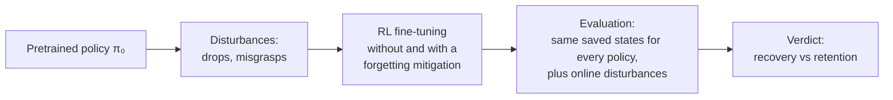
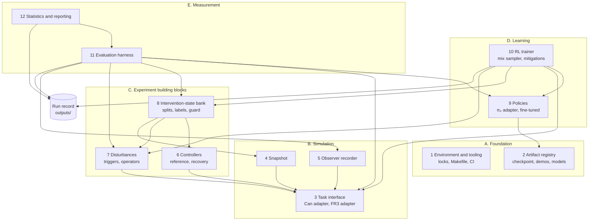
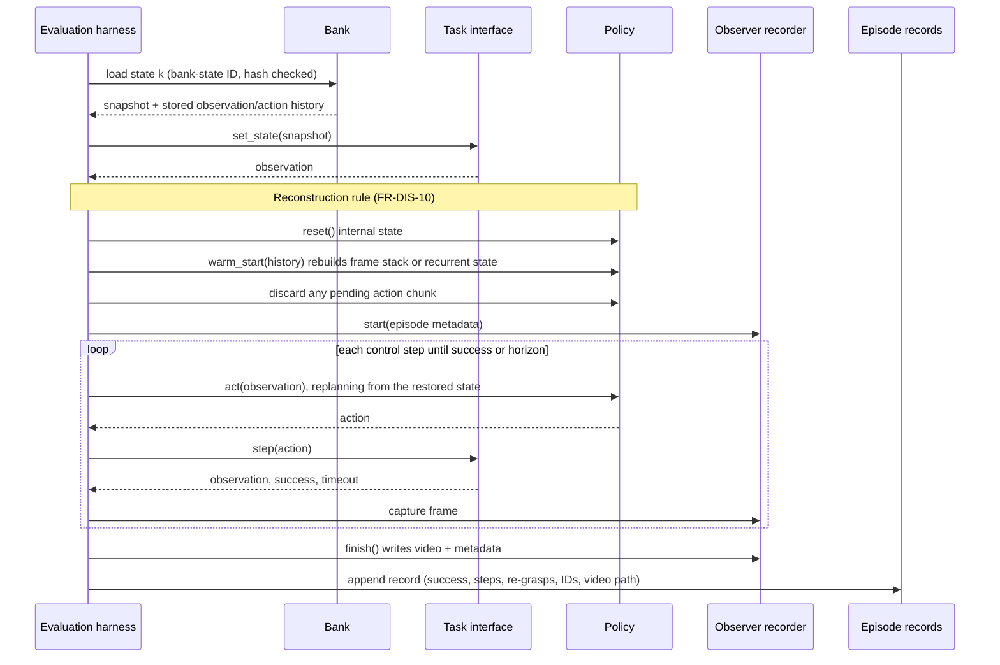
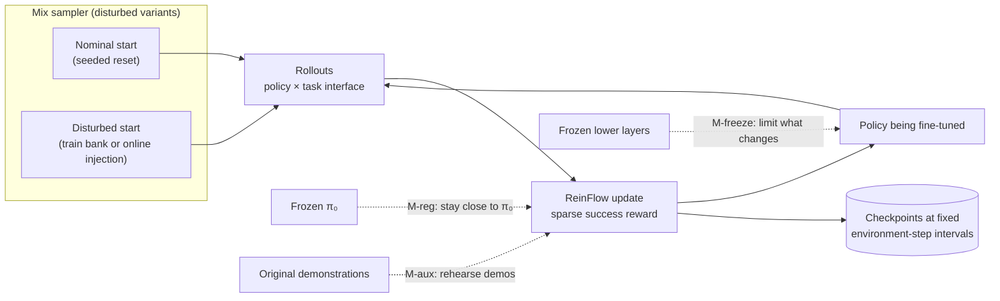
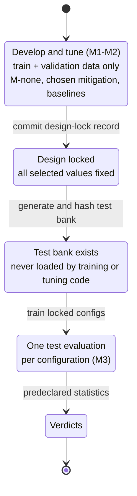
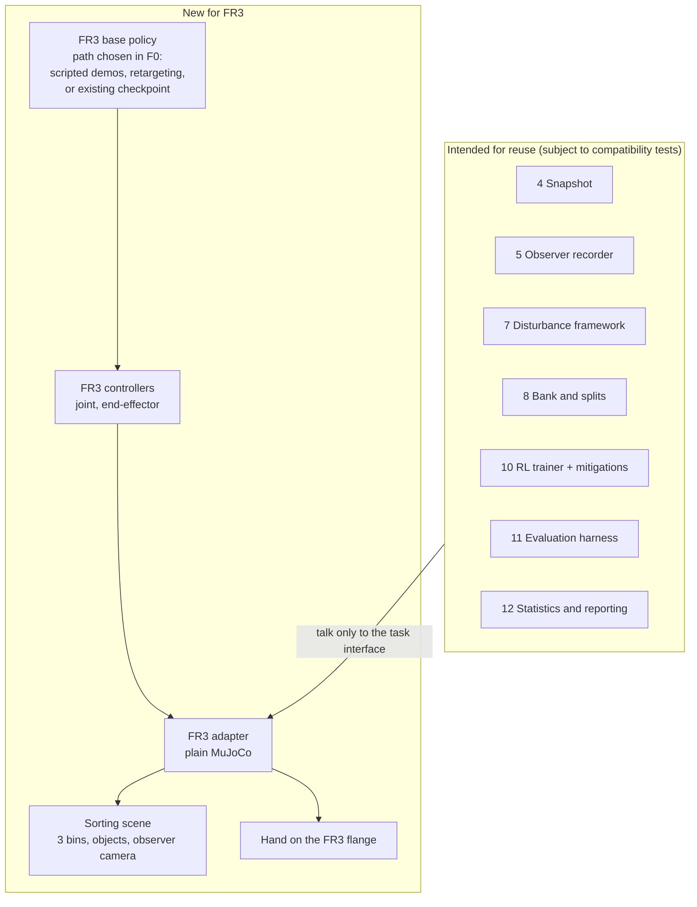
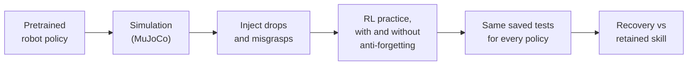

# System architecture

Status: draft. This is the big picture of the intended Afterslip system: its components, how they depend on each other, and how data and control flow through them. It describes the target architecture; most components do not exist yet, and the status column says which do. Interfaces and detailed decisions are in [design.md](design.md); work items are in [milestones.md](milestones.md); the [requirements](requirements.md) remain authoritative.

## 1. Overview

Afterslip takes a pretrained robot policy (π₀), lets it practise recovering from injected drops and misgrasps with reinforcement learning, and measures two things for every policy: how often it recovers, and how much of its original skill it keeps. The primary disturbed comparison starts every policy from the **same** saved disturbed states; a secondary suite injects disturbances during each policy's own rollouts.

The system has **12 components in five layers**, plus a run record shared by all of them.

| Layer | Component | Purpose | Status (2026-11-19) |
|---|---|---|---|
| A. Foundation | 1. Environment and tooling | Locked environment, Makefile, tests, CI | Partly exists: locks and Makefile validated on macOS only; Linux install and CI not yet validated (M0 0.0c) |
| | 2. Artifact registry | Verified checkpoints, demonstrations, robot models, with hashes and licenses | Planned (M0 0.1, 0.2) |
| B. Simulation | 3. Task interface and adapters | The only door to the simulator; Core (robosuite Can) and FR3 (MuJoCo) adapters | Core adapter exists (M0 D1); FR3 adapter in F0 |
| | 4. Snapshot | Save and restore the full environment state | In-memory snapshots on one backend exist (M0 D2); serialization and hashing in M2. A simulator-state-only diagnostic fails as expected |
| | 5. Observer recorder | Videos from one fixed camera, with metadata | Exists (M0 D1) |
| C. Experiment building blocks | 6. Controllers | Fixed reference controller (scripted or π₀, chosen at M0) that reaches disturbance triggers; recovery controller that labels states | Planned (M0 0.5a, M2) |
| | 7. Disturbances | Triggers (when) and operators (what): drop, misgrasp, knock | Planned (M2) |
| | 8. Intervention-state bank | Generated disturbed states, recoverability labels, train/validation/test splits, hashes, test-access guard | Planned (M2) |
| D. Learning | 9. Policies | π₀ adapter, fine-tuned policies, toy policies; reset/reconstruction rule | Planned (M0, M1, M2) |
| | 10. RL trainer | ReinFlow wrapper, nominal/disturbed mix sampler, mitigation hooks | Planned (M1, M2) |
| E. Measurement | 11. Evaluation harness | Nominal, bank-based disturbed and end-to-end suites; per-episode records | Planned (M0, M2, M3) |
| | 12. Statistics and reporting | Hierarchical bootstrap, verdicts, headline figure, reports | Planned (M2, M3, M5) |
| (shared) | Run record | Config, commits, artifact hashes, runtime versions, outputs | Planned (M1) |

## 2. Component diagram

Arrows point from a component to what it uses.

Design rules visible in the diagram:
- Everything that touches the simulator goes through the **task interface** (3). Swapping the robot is intended to mean a new adapter, not changes elsewhere.
- For the **primary disturbed suite**, the **bank** (8) supplies the starting states, so every policy is tested from identical physical and task states. The **end-to-end suite** (FR-EVAL-08) instead injects disturbances online during each policy's own rollout from nominal test seeds; it is reported separately with its trigger rate. The evaluation harness therefore uses both the bank and the disturbance module.
- During training, disturbed episodes come either from the **train** bank or from online injection (FR-DIS-08, decided in M2), so the trainer can use both.
- **Statistics** (12) read only recorded episodes, never the simulator, so every figure can be regenerated from logs.

## 3. Data flow: from artifacts to verdicts

What is produced, in order. Boxes are artifacts (files); labels on arrows say what produces them.

```mermaid
flowchart LR
    CK[("π₀ checkpoint<br/>+ hash")]
    DEMO[("Verified demonstrations")]
    REF["Fixed reference controller<br/>scripted or π₀"]
    BTV[("Bank: train + validation<br/>+ labels + hashes")]
    SEL[("Validation selection log<br/>M-none, chosen mitigation,<br/>baselines")]
    LOCK{{"Design-lock record<br/>committed before test bank"}}
    BT[("Bank: test<br/>+ hash")]
    FT[("Final checkpoints<br/>per configuration and seed")]
    EP[("Episode records + videos<br/>nominal, bank-based disturbed,<br/>end-to-end disturbed")]
    FIG[("Tables, headline figure,<br/>verdicts, report")]

    DEMO -- "pretraining, Path 2 only" --> CK
    CK -.-> REF
    REF -- "trigger, disturb, snapshot,<br/>label recoverability" --> BTV
    BTV -- "tuning on train/validation<br/>(or online injection)" --> SEL
    SEL --> LOCK
    LOCK -- "generated only after the lock" --> BT
    LOCK -- "final training,<br/>locked configs" --> FT
    FT -- "one test evaluation<br/>per configuration" --> EP
    CK --> EP
    BT --> EP
    EP -- "bootstrap, verdict rules" --> FIG
```

The dotted arrow marks the option that π₀ is the reference controller; the alternative is a scripted controller (chosen at M0, milestone 0.5a).

## 4. One bank-based disturbed evaluation episode

How the components interact when a policy is evaluated from one bank state. The same sequence runs for π₀ and for every final policy, from the same state.

The reconstruction rule is a practical approximation; it does not guarantee identical hidden policy state across architectures. A policy type that cannot be initialised this way is reported as a limitation, and its disturbed results come from the end-to-end suite instead. The end-to-end suite itself runs a nominal episode from a test seed, injects the disturbance online when the trigger fires during the policy's own rollout, and records the trigger rate.

## 5. Training loop with disturbances and mitigation

How fine-tuning mixes normal and disturbed practice, and where a forgetting mitigation acts. The Core comparison always includes **M-none** (plain fine-tuning, no mitigation) and **one** chosen mitigation; the others are Extended. All hyperparameters, including the mitigation's, are selected on validation data before the design lock.

Dotted arrows are optional: **M-none uses none of them**; each mitigation variant uses exactly one. The nominal-only baseline uses only nominal starts.

## 6. The fair-test protocol

The order in which data may be used. This makes the final comparison trustworthy: nothing about the design is chosen by looking at test results. The requirement is that the design-lock record is committed **before** the test bank exists (FR-DIS-05); a git tag is the proposed mechanism for proving the order.

## 7. FR3 track: intended reuse

The FR3 track applies the same machinery to the Franka Research 3 arm in a three-bin sorting scene. **This is an architectural goal, not a guarantee:** each reused component must pass compatibility tests with the FR3 adapter before it is relied on, and changes are made where tests show they are needed.

The FR3 track has two phases. **F0** (alongside M0–M2) builds the adapter, hand and controllers step by step, each with a video, and ends with a decision on the F1 path. **F1** (after M3) builds the sorting scene and base policy, then runs the method in a scope decided at F1 entry: a **demonstration**, or a **research comparison**. A research comparison has its own train/validation/test data, its own validation-only selection and its own design lock (section 6, repeated for FR3); values locked for Core are not assumed to transfer.

## 8. Simplified view for the README

## 9. Animation (planned)

An animated SVG of the end-to-end flow (sections 3 and 4 combined), in the style of the explainer animations and generated by a script like `docs/explainer/make_svgs.py`, is planned once the pipeline runs end to end (after M2–M3), so that it shows the real system rather than a plan.
