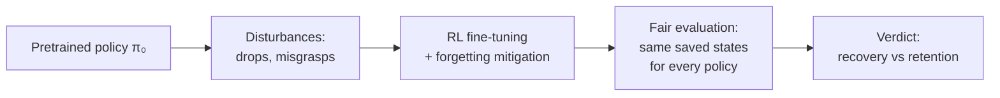
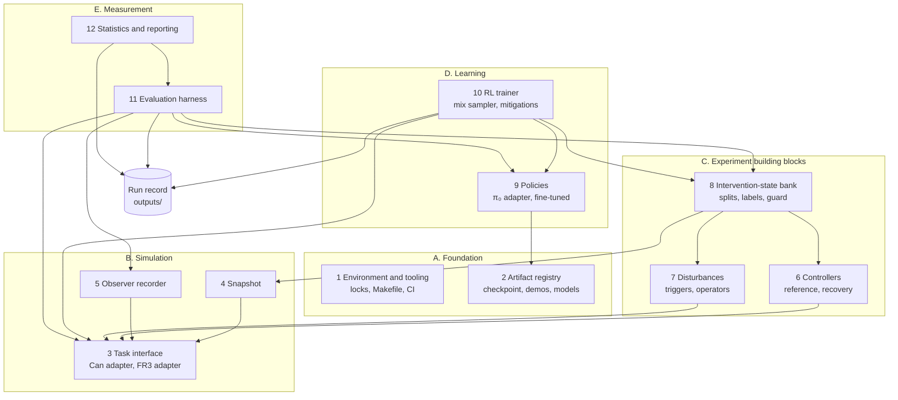
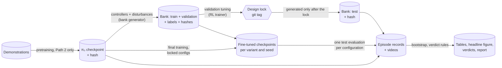
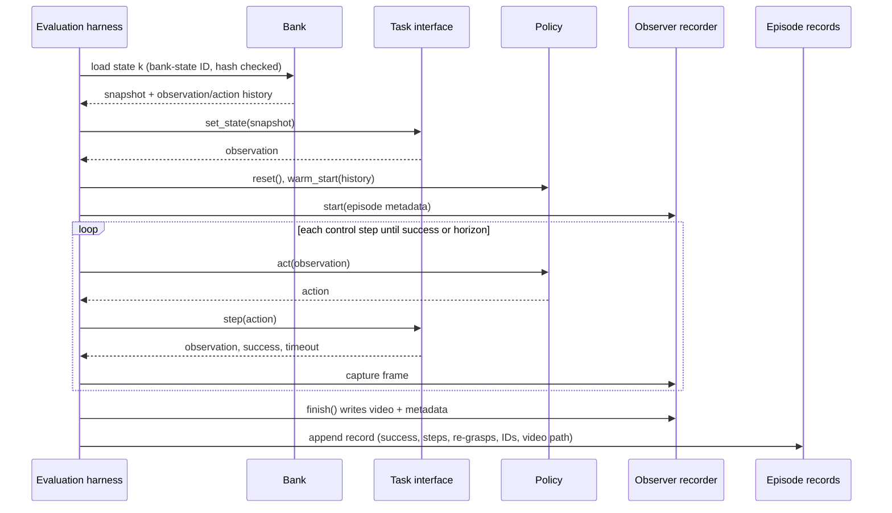
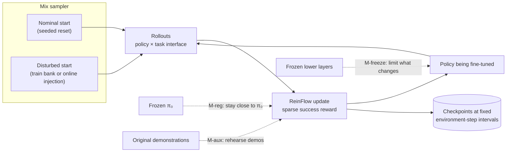
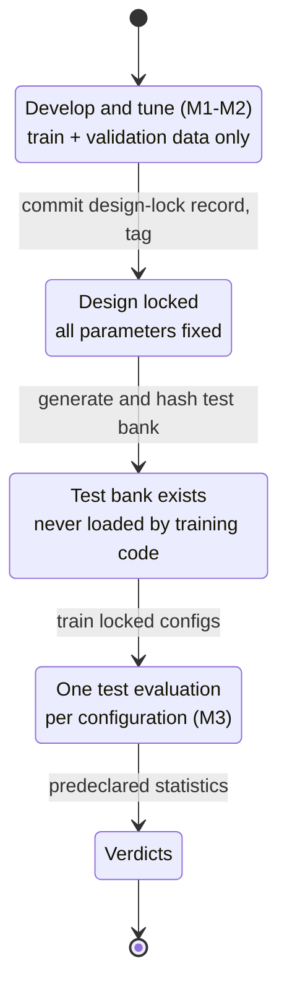
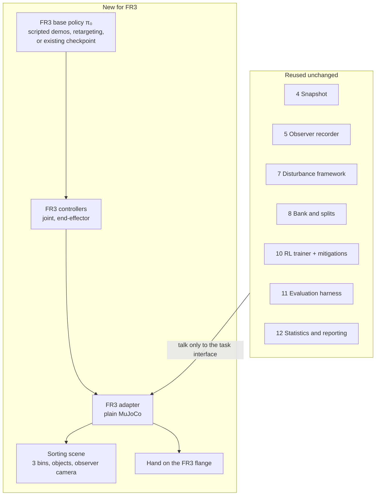
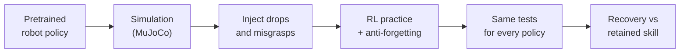

# System architecture

Status: draft. This is the big picture of the finished Afterslip system: its components, how they depend on each other, and how data and control flow through them. Interfaces and detailed decisions are in [design.md](design.md); work items are in [milestones.md](milestones.md). Components that do not exist yet are marked with the milestone that builds them.

## 1. Overview

Afterslip takes a pretrained robot policy (π₀), lets it practise recovering from injected drops and misgrasps with reinforcement learning, and measures two things on the **same** saved disturbances for every policy: how often it recovers, and how much of its original skill it keeps.

The system has **12 components in five layers**, plus a run record shared by all of them.

| Layer | Component | Purpose | Built in |
|---|---|---|---|
| A. Foundation | 1. Environment and tooling | Locked environment, Makefile, tests, CI | M0 (exists) |
| | 2. Artifact registry | Verified checkpoints, demonstrations, robot models, with hashes and licenses | M0 |
| B. Simulation | 3. Task interface and adapters | The only door to the simulator; Core (robosuite Can) and FR3 (MuJoCo) adapters | M0 (D1), F0 |
| | 4. Snapshot | Save and restore the full environment state | M0 (D2), M2 |
| | 5. Observer recorder | Videos from one fixed camera, with metadata | M0 (D1) |
| C. Experiment building blocks | 6. Controllers | Scripted reference controller (makes disturbances happen) and recovery controller (labels states) | M0, M2 |
| | 7. Disturbances | Triggers (when) and operators (what): drop, misgrasp, knock | M2 |
| | 8. Intervention-state bank | Generated disturbed states, recoverability labels, train/validation/test splits, hashes, test-access guard | M2 |
| D. Learning | 9. Policies | π₀ adapter, fine-tuned policies, toy policies; reset rule | M0, M1 |
| | 10. RL trainer | ReinFlow wrapper, nominal/disturbed mix sampler, mitigation hooks | M1, M2 |
| E. Measurement | 11. Evaluation harness | Nominal, disturbed and end-to-end suites; per-episode records | M0, M2, M3 |
| | 12. Statistics and reporting | Hierarchical bootstrap, verdicts, headline figure, reports | M2, M3, M5 |
| (shared) | Run record | Config, commit, artifact hashes, runtime versions, outputs | M1 |

## 2. Component diagram

Arrows point from a component to what it uses.

Design rules visible in the diagram:
- Everything that touches the simulator goes through the **task interface** (3). Swapping the robot means a new adapter, not changes elsewhere.
- The **bank** (8) is the only source of disturbed starting states for evaluation, so every policy is tested from identical states.
- **Statistics** (12) read only recorded episodes, never the simulator, so every figure can be regenerated from logs.

## 3. Data flow: from artifacts to verdicts

What is produced, in order. Boxes are artifacts (files); labels on arrows are the components that produce them.

## 4. One disturbed evaluation episode

How the components interact when a policy is evaluated from one bank state. The same sequence runs for π₀ and for every fine-tuned policy, from the same state.

## 5. Training loop with disturbances and mitigation

How fine-tuning mixes normal and disturbed practice, and where the forgetting mitigation acts.

Only one mitigation is used in the Core comparison (chosen in M0); the others are Extended.

## 6. The fair-test protocol

The order in which data may be used. This is what makes the final comparison trustworthy: nothing about the design is chosen by looking at test results.

## 7. FR3 track: what is reused and what is new

The FR3 track applies the same machinery to the Franka Research 3 arm in a three-bin sorting scene. Only the robot- and task-specific parts are new.

The FR3 track proceeds in two phases: **F0** (alongside M0–M2) builds N1, N3 and N4 step by step, each with a video; **F1** (after M3) adds N2 and N5 and runs the method. An FR3 research comparison uses its own train/validation/test protocol and lock (section 6, repeated for FR3).

## 8. Simplified view for the README

## 9. Animation (planned)

An animated SVG of the end-to-end flow (sections 3 and 4 combined), in the style of the explainer animations and generated by a script like `docs/explainer/make_svgs.py`, is planned once the pipeline runs end to end (after M2–M3), so that it shows the real system rather than a plan.
