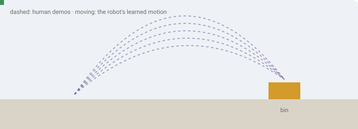
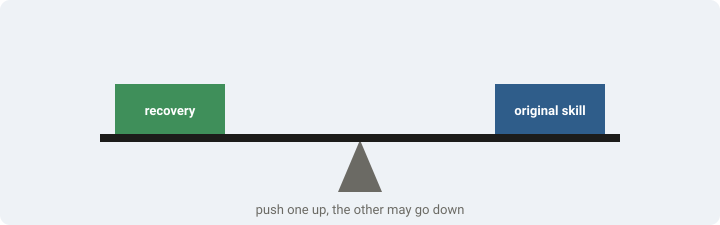
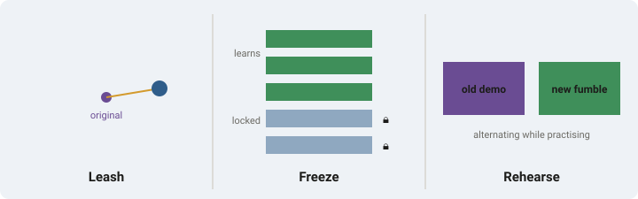

# Afterslip: Recover Without Forgetting
### Teaching a robot a new trick, without making it forget the old ones

*An explainer for Afterslip · about 3 minutes · the animations illustrate ideas and hypotheses, not results*

---

## The whole story in 10 seconds

A robot arm sorts recyclables into three bins: **plastic**, **metal** and **paper**. Same arm, same slip of a metal item. On the left, a robot that only ever **copied** humans freezes. On the right, the same robot after **practice** picks the item back up and sorts it. The question this project asks is in the meters underneath: *did learning to recover cost it any of its original skill?*

The three-bin sorter is where the project is headed. The first experiments start simpler, with a single can and one bin (the chapters below), and add the sorter once the method works.

---

## 1 · A robot that learned by watching

Show a robot arm a few hundred human demonstrations of picking up a can and putting it in a bin, and it learns to copy them. This is **imitation learning**. It works remarkably well as long as the world looks like the demos.

## 2 · Then the can slips

A grip loosens and the can falls. Now the robot is somewhere no demo ever went. A copier has nothing to copy, so it hesitates or flails.

> **Imitation teaches a robot the path. It doesn't teach it what to do off the path.**

## 3 · How the robot "imagines" a move

Our robot uses a **flow-matching policy**, a cousin of the AI image generators that paint pictures out of noise. Instead of pixels, it sculpts a smooth arm motion out of random wiggles in a few quick refinement steps.

## 4 · Learning from trial and error

To teach recovery, we knock the can loose on purpose, thousands of times in simulation, and reward the robot whenever it picks it back up and finishes the job. This is **reinforcement learning (RL)** used as a finishing school: the same *pretrain, then fine-tune with RL* recipe now used to sharpen large AI models.

## 5 · The catch: forgetting

Practising only on fumbles can quietly erode what the robot already did well. Push hard on the new skill and the old one may slip. Researchers call this **catastrophic forgetting**.

## 6 · Three ways to remember

- **The leash:** penalise the robot for drifting too far from its original behaviour.
- **The freeze:** lock the lower layers of its network, the part that "sees".
- **The rehearsal:** keep mixing old demos in while it practises.

Nobody knows yet which works best for this kind of robot. That is what we'll find out.

## 7 · How we'll know

A fair test: every robot faces the **exact same** set of fumbles, replayed from saved snapshots. Each one gets two scores: how often it **recovers**, and how much of the **original job** it still does well. The winner sits in the top-right corner. *The positions shown are made up; the real ones come from the experiments.*

---

## Why it matters

Tomorrow's robots will be pretrained on huge piles of demonstrations, then sharpened with practice, and every round of practice risks forgetting. A clear answer to *"how do you add a skill without losing one?"* is useful far beyond one arm and one can. We'll report the answer honestly, whatever it turns out to be.

---

**Go deeper:** [Requirements](requirements.md) (what we'll build) · [README](../README.md) (getting started)
**Key ideas from:** ReinFlow ([L015](https://arxiv.org/abs/2505.22094)) · DPPO ([L008](https://arxiv.org/abs/2409.00588)) · RL post-training of robot policies ([L017](https://arxiv.org/abs/2602.12628)) · forgetting mitigations ([L020](https://arxiv.org/abs/2603.10263), [L021](https://arxiv.org/abs/2603.12868))
Simulated in MuJoCo. Animations are generated by [explainer/make_svgs.py](explainer/make_svgs.py) and play in GitHub, VS Code preview and browsers. They are illustrations, not results.
