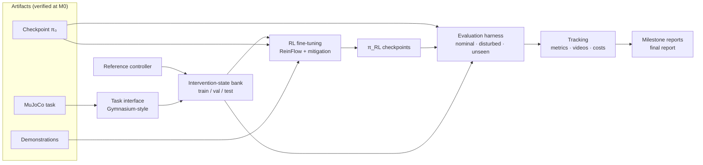

# Afterslip: Requirements
### "Recover without forgetting"
#### RL post-training of a pretrained flow-matching manipulation policy

| | |
|---|---|
| **Version** | v1.1 draft (adds the FR3 track, §6.9; v1.0 was approved after three rounds of independent review) |
| **Date** | 2026-11-14 |
| **Origin** | Selected in an internal research review (robotics-discussion, decision D001, 2026-11-14). The story version is [explainer.md](explainer.md). |
| **Audience** | Development and research engineering team |
| **Requirement keywords** | **SHALL** = mandatory · **SHOULD** = expected unless a reason is documented · **MAY** = optional |

> **Status of choices.** The project *direction* was selected in the research review (D001). The specific task, algorithm, mitigations and protocol in this document are **proposed implementation choices**, pending the artifact and prior-work checks at M0. Claims about expected behaviour are **hypotheses**, not facts.

---

## 1. Purpose
Build a reproducible, pure-simulation research system in MuJoCo that answers one question:

> **RQ.** When a pretrained flow-matching manipulation policy is fine-tuned with online RL on injected failures (drops, misgrasps), how does its success on **disturbed** episodes change, how does its success on the **original** task change, and does a **forgetting mitigation** improve that trade-off?

A negative or inconclusive answer is a valid outcome. The project succeeds if the question is answered with sound measurements, whatever the answer is.

## 2. Background (abstract-level evidence; to be read in full at M0)
- Robot learning is moving to *imitation pretraining → RL post-training*. RL in simulation has improved pretrained policies ([L017](https://arxiv.org/abs/2602.12628), [L018](https://arxiv.org/abs/2603.18532)).
- ReinFlow ([L015](https://arxiv.org/abs/2505.22094), NeurIPS 2025) fine-tunes flow-matching policies with online policy gradients. Its project page links code, data and checkpoints for tasks including Robomimic Can, Square and Transport, and states an MIT license for its released materials. The license of **each** checkpoint, dataset and benchmark asset still has to be verified individually (FR-ART-02). DPPO ([L008](https://arxiv.org/abs/2409.00588)) is the diffusion-policy counterpart.
- RL fine-tuning may erode pretrained behaviour. Mitigations used in related work include an auxiliary imitation loss ([L017](https://arxiv.org/abs/2602.12628)), behaviour regularization ([L020](https://arxiv.org/abs/2603.10263)) and layer freezing ([L021](https://arxiv.org/abs/2603.12868)). An abstract-level search found no direct recovery-vs-retention comparison; a full-text check is required at M0 (FR-NOV-01).

## 3. Scope

### 3.1 Scope tiers
| Tier | Content | Commitment |
|---|---|---|
| **Core** (required) | One task; base policy π₀; nominal-only fine-tuning; disturbed fine-tuning without mitigation; **one** mitigation chosen and justified at M0; baselines FR-BASE-01, -03, -04; evaluation suites; report | Must be delivered |
| **Extended** | Remaining mitigations; hyperparameter sweeps; FR-BASE-02 (extra imitation); generalization suite E5 | Delivered if Core finishes within the M3 budget |
| **FR3 track** | F0: FR3 learning and feasibility sequence (model, control, kinematics, hand, grasp), with recorded videos. F1: FR3 sorting scene and the Afterslip method applied to it, after Core (§6.9) | F0 committed, runs alongside M0–M2; its costs and schedule impact on Core are recorded and reviewed. F1 committed after M3, with its path and scope (demonstration or research comparison) set by the F0 feasibility decision (FR-FR3-03) |
| **Stretch** | Second algorithm (DPPO); second task (Square) | Optional |

Difficulty and compute are **unmeasured estimates** until M1 reports actuals (NFR-CMP-02).

### 3.2 Out of scope (non-goals)
Real hardware and sim-to-real; training a large VLA; inventing a new RL algorithm; photorealistic rendering; multi-robot or mobile manipulation.

## 4. Glossary
| Term | Meaning |
|---|---|
| **π₀** | The pretrained flow-matching base policy, frozen and hashed. |
| **π_RL** | π₀ after RL post-training under one variant. |
| **Variant** | One fine-tuning configuration: algorithm × mitigation × hyperparameters × disturbance curriculum. |
| **Horizon H** | The maximum steps per episode, taken from the task's standard horizon. Reaching H without success = failure (timeout). |
| **Nominal episode** | An episode from the original task distribution, with no injected disturbance. |
| **Intervention state** | A full simulator snapshot taken immediately after a disturbance is applied (§6.3). |
| **Intervention-state bank** | A fixed, policy-independent set of intervention states, generated once and replayed for every policy (FR-DIS-04). |
| **Disturbed episode** | An episode that starts from an intervention state and runs to success or the remaining horizon. |
| **Oracle-verified recoverable** | An intervention state from which a reference controller succeeded in at least one of N attempts. |
| **Unknown recoverability** | An intervention state where the reference controller did not succeed. This does **not** prove the state is unrecoverable. |
| **Trigger rate** | During bank generation, the fraction of attempted episodes in which the disturbance trigger condition occurred. |

## 5. System overview

## 6. Functional requirements

**Observation note:** Simulator-provided object state is privileged information; real transfer requires an appropriate real-world sensing and estimation interface and has not been demonstrated.

### 6.1 Artifacts and novelty gate (ART, NOV)
| ID | Requirement |
|---|---|
| FR-ART-01 | At M0 the team **SHALL** produce an **artifact selection decision** naming the task, observation modality, checkpoint (if any) and demonstrations, chosen by the decision table in §6.1.1. |
| FR-ART-02 | Every artifact (code, checkpoint, dataset, robot model, scene asset) **SHALL** be recorded in `ARTIFACTS.md` with source URL, exact version or content hash, license as stated by its own source, and the date checked. An artifact whose license or access cannot be verified **SHALL NOT** be used. |
| FR-ART-03 | The policy's architecture, observation keys, preprocessing and normalization, action space, action chunking and denoising-step count **SHALL** match the chosen checkpoint exactly, as read from its released config. |
| FR-NOV-01 | Before M3 begins, the team **SHALL** complete a full-text prior-work review on "RL fine-tuning of diffusion/flow policies: recovery vs retention" and record whether the RQ is novel, partially answered, or answered. If it is answered, the project is re-scoped as a replication or extension, subject to an approved re-scope decision. |

#### 6.1.1 Artifact decision table (M0)
| Situation | Action |
|---|---|
| Licensed state-based checkpoint and demonstrations available, and π₀ reproduction protocol passes (FR-POL-01) | **Path 1:** use the released π₀. |
| Licensed demonstrations, but no usable state-based checkpoint (including image-only availability), or reproduction fails | **Path 2:** pretrain π₀ ourselves (FR-POL-03); report the reproduction failure. |
| No licensed demonstrations for the benchmark task | **Path 3:** stop and submit a re-scope decision for approval, with a proposal to generate scripted demonstrations in a custom MuJoCo scene (Menagerie Panda, [L007](https://github.com/google-deepmind/mujoco_menagerie)). |

### 6.2 Task interface and environment (ENV)
| ID | Requirement |
|---|---|
| FR-ENV-01 | MuJoCo **SHALL** be the only physics engine. |
| FR-ENV-02 | The proposed primary task is **Robomimic Can** (confirmed or replaced by FR-ART-01). |
| FR-ENV-03 | Environments **SHALL** be wrapped in a Gymnasium-style task interface (`reset`, `step`, `get_state`, `set_state`) so training and evaluation code never touch benchmark internals. |
| FR-ENV-04 | The interface **SHALL** support saving and restoring an **environment snapshot**: MuJoCo state (qpos, qvel, act, warm-start where available), task state (object poses, goal, success flags), low-level controller internal state, environment RNG states and intervention metadata. It **SHALL** also store the **pre-intervention observation and action history** (the last k steps, k in config). It **SHALL NOT** store or transfer any policy's internal state (recurrent state, pending action chunk, sampling noise) between policies. |
| FR-ENV-05 | Episodes **SHALL** have a fixed horizon H (§4). The success predicate **SHALL** be the benchmark's own, recorded per step. |
| FR-ENV-06 | The interface **SHALL** support vectorized rollouts with a configurable worker count. |
| FR-ENV-07 | The system **SHALL** define an **unseen-arrangement** distribution (object initial poses outside the training range, specified numerically in config) for the generalization suite. |

### 6.3 Disturbances and the intervention-state bank (DIS)
| ID | Requirement |
|---|---|
| FR-DIS-01 | Disturbance types **SHALL** include **D1 drop** (gripper forced open while the object is carried) and **D2 misgrasp** (object pose perturbed at grasp closure). **D3 knock** (impulse on the object before grasp) **SHOULD** be included. |
| FR-DIS-02 | Each type **SHALL** be parameterized by trigger condition, magnitude range and the probability that an episode is selected for intervention. |
| FR-DIS-03 | Triggers **SHALL** be predicates on simulator and task state (e.g. D1: object above height h and in contact with both fingers), documented in code and in the report. |
| FR-DIS-04 | Intervention states for **evaluation** **SHALL** be generated **once** by rolling out a fixed reference controller (scripted controller or π₀, chosen and recorded at M0) until the trigger fires, applying the disturbance and saving the environment snapshot and history (FR-ENV-04). Every evaluated policy **SHALL** start disturbed episodes from these identical *physical and task* states, so the starting conditions are independent of the policy under test. |
| FR-DIS-10 | **Policy-state reconstruction rule.** At the start of a disturbed episode, each policy **SHALL** be initialised by the same rule: reset its internal state; feed it the stored observation history (and action history, if its inputs use past actions) to rebuild any frame stack or recurrent state; discard any pending action chunk; and replan from the restored state. The rule **SHALL** have a unit test per policy type. A policy that cannot be initialised this way **SHALL** be reported as a limitation, with results from FR-EVAL-08 instead. The rule is a practical approximation to a comparable history; it does not prove that a policy's hidden state matches what it would have had on a real trajectory. Results **SHALL NOT** claim identical internal policy state across architectures, and the FR-EVAL-08 end-to-end suite **SHALL** always be reported alongside. |
| FR-DIS-05 | The bank **SHALL** be split into disjoint **train / validation / test** sets with recorded seeds and hashes. All design decisions (disturbance magnitudes, curriculum, reward shaping, mitigation choice, hyperparameters, the M2 headroom review) **SHALL** use train and validation states only. The **test** bank **SHALL** be generated and hashed only after the design is locked at the end of M2, and **SHALL NOT** be used for training, tuning, demonstration collection or design changes. |
| FR-DIS-06 | During bank generation the system **SHALL** record the trigger rate; attempts in which the trigger never fires within H **SHALL** be logged and excluded from the bank, with their count reported. |
| FR-DIS-07 | Each bank state **SHALL** be labelled **oracle-verified recoverable** or **unknown recoverability** using a reference recovery controller with N attempts (N in config). |
| FR-DIS-08 | During RL training, disturbances **MAY** be injected online (policy-dependent) from the **train** distribution, or drawn from the train bank; the choice **SHALL** be recorded. |
| FR-DIS-09 (Extended) | For E5, evaluation **SHALL** include disturbance magnitudes from a held-out range not used in training. |

### 6.4 Policies (POL)
| ID | Requirement |
|---|---|
| FR-POL-01 | Path 1 only: the team **SHALL** run a recorded reproduction protocol (fixed seeds, ≥ 200 episodes, 95% CI) on π₀ and compare it with the released figure. Agreement or disagreement **SHALL** be reported. The tolerance **SHALL** be fixed in writing before the run. |
| FR-POL-02 | π₀ **SHALL** be frozen and content-hashed; every variant **SHALL** start from that hash. |
| FR-POL-04 | Policies in both tracks **SHALL** use low-dimensional state inputs, without camera images; recording uses one observer camera whose images are not policy inputs. Exact inputs and compatibility are verified with the selected artifacts. |
| FR-POL-03 | Path 2: π₀ **SHALL** be pretrained by flow-matching behaviour cloning on the verified demonstrations, using the configuration published with the reference code, and evaluated by the FR-POL-01 protocol. |

### 6.5 RL fine-tuning (RL)
| ID | Requirement |
|---|---|
| FR-RL-01 | The proposed primary algorithm is **ReinFlow** ([L015](https://arxiv.org/abs/2505.22094)), using the official implementation as the reference. |
| FR-RL-02 | The reward **SHALL** be the benchmark's sparse success reward. Any shaping **SHALL** be documented and applied identically to all variants. |
| FR-RL-03 | **Disturbed variants** (M-none and mitigations) **SHALL** train on a mix of nominal and disturbed episodes at a configurable ratio, with an optional magnitude curriculum. The nominal-only baseline (FR-BASE-04) trains on nominal episodes only. |
| FR-RL-04 | Mitigation variants (all from the same π₀): **M-none** (plain fine-tuning; always run); **M-reg** (regularizer toward π₀, weight λ); **M-freeze** (encoder and lower layers frozen, depth d); **M-aux** (auxiliary flow-matching loss on the original demonstrations, weight β). **Core** requires M-none plus one mitigation chosen at M0 with a written justification; the rest are **Extended**. |
| FR-RL-05 | Hyperparameters (λ, d, β and RL settings) **SHALL** be selected on the **validation** bank and validation nominal seeds only. Test results **SHALL** be computed once per selected configuration. |
| FR-RL-06 | Checkpoints **SHALL** be saved at fixed environment-step intervals. |
| FR-RL-07 | A run that diverges or crashes **SHALL** be kept in the record. Restarts **SHALL** use a new seed and be reported; seeds **SHALL NOT** be silently replaced. |
| FR-RL-08 (stretch) | DPPO ([L008](https://arxiv.org/abs/2409.00588)) **MAY** be added on the same harness. |

### 6.6 Baselines (BASE)
| ID | Baseline | Tier |
|---|---|---|
| FR-BASE-01 | π₀ alone. | Core |
| FR-BASE-03 | RL from scratch (PPO or SAC) with the same observations, reward and environment-step budget. | Core |
| FR-BASE-04 | ReinFlow fine-tuning on nominal episodes only (no disturbances). | Core |
| FR-BASE-02 | Extra imitation: π₀ further trained on demonstrations that include scripted recoveries from **train-bank** intervention states. Its resources (demos, environment interactions to collect them, labelling and compute) **SHALL** be accounted separately. Comparison budgets **SHALL** be pre-specified, and the report **SHALL NOT** claim the budgets are equivalent to RL's. | Extended |

### 6.7 Evaluation (EVAL)
| ID | Requirement |
|---|---|
| FR-EVAL-01 | Every policy **SHALL** be evaluated on: **Nominal** (fixed test seeds), **Disturbed** (all test-bank intervention states) and, in Extended, **Unseen arrangement**. |
| FR-EVAL-02 | Each suite **SHALL** use ≥ 200 episodes per policy (Disturbed: all test-bank states, with the bank sized to provide ≥ 200). |
| FR-EVAL-03 | Every Core comparison **SHALL** use ≥ 5 training seeds. Results **SHALL** report mean and 95% CI over seeds (bootstrap), plus per-seed values. |
| FR-EVAL-04 | Per episode, the harness **SHALL** record: success, steps to success or timeout, re-grasp attempts, disturbance type and parameters, recoverability label, and bank-state ID. |
| FR-EVAL-05 | The harness **SHALL** compute action divergence from π₀ on a fixed set of validation nominal states. |
| FR-EVAL-06 | The harness **SHALL** render videos for a fixed subset of test seeds and bank states for π₀ and every final variant. |
| FR-EVAL-07 | Evaluation **SHALL** run standalone on any checkpoint with one documented command. |
| FR-EVAL-08 | A secondary **end-to-end disturbed suite** **SHALL** inject disturbances online during each policy's own rollouts from nominal test seeds (policy-dependent trigger timing). It is reported separately with its trigger rate, and it covers policies to which FR-DIS-10 cannot apply. |

### 6.8 Tracking, deliverables and reporting (TRK)
| ID | Requirement |
|---|---|
| FR-TRK-01 | Every run **SHALL** log config, git commit, artifact hashes, seeds, hardware, OS, backend, library versions, environment steps and wall-clock. |
| FR-TRK-02 | A local file-based logger **SHALL** always work; external trackers are optional plug-ins. |
| FR-TRK-03 | The headline figure **SHALL** plot disturbed success (y) against nominal success (x) for every variant and baseline, with CI bars, and mark π₀. |
| FR-TRK-04 | Learning curves (nominal and disturbed success vs environment steps) **SHALL** be produced per variant. |
| FR-TRK-05 | Each milestone **SHALL** end with a short **milestone report**: what was done, measurements, costs, deviations, negative or inconclusive findings, and the go/review decision. |
| FR-TRK-06 | Final deliverables: source code; `ARTIFACTS.md`; environment lock files; the intervention-state banks with hashes; all configs; selected checkpoints; raw per-episode logs; figures; videos; milestone reports; final report. |

### 6.9 FR3 track (FR3)
The FR3 track uses the Franka Research 3 arm in MuJoCo. It is reported separately from Core: Core comparisons, hypotheses and verdicts use the Core task selected under FR-ART-01 (proposed: Robomimic Can, FR-ENV-02), and FR3 results do not enter Core verdicts. Compute, effort and schedule used by the FR3 track, and any impact on Core, **SHALL** be recorded in each milestone report and reviewed.

| ID | Requirement |
|---|---|
| FR-FR3-01 | The FR3 robot model, any gripper (hand) model, and any checkpoint, demonstration set or scene asset used in the FR3 track **SHALL** each be recorded and verified in `ARTIFACTS.md` under FR-ART-02 and NFR-LIC-01 before use. The choice of model source is part of F0; no particular FR3 model is assumed. |
| FR-FR3-02 | **F0 feasibility sequence.** The following steps **SHALL** each produce a recorded video with metadata (FR-EVAL-06 recorder) and a short written result: (a) load and inspect the model (joints, limits, actuators) and render it; (b) joint-space control to commanded configurations; (c) forward kinematics and an end-effector position controller, with the measured end-effector position error on a fixed set of targets; (d) a gripper on the arm (attached if the model has none) grasping and lifting a block, with the measured grasp success on a fixed set of trials. A step that cannot be completed **SHALL** be recorded as BLOCKED with its cause. |
| FR-FR3-03 | **F1 path decision.** Before F1 commits to a pretraining or transfer path, a written feasibility decision **SHALL** compare the available paths with evidence, effort and compute estimates, and risks: at least (i) scripted demonstrations in the FR3 sorting scene with flow-matching pretraining; (ii) retargeting existing licensed demonstrations to FR3 (e.g. through inverse kinematics); (iii) any licensed FR3 checkpoints or demonstrations found. Time and compute **SHALL** remain open estimates until this decision. |
| FR-FR3-04 | **F1 task definition.** The FR3 sorting task **SHALL** be specified numerically before demonstrations or policies are produced: object set and categories, bins and their positions, initial-state distribution, success predicate (all objects in their correct bins), and horizon. |
| FR-FR3-05 | **F1 evaluation protocol.** If F1 includes a research comparison (e.g. π₀ vs fine-tuned, or a mitigation comparison), it **SHALL** follow its own protocol analogous to Core: separate train/validation/test seeds and intervention-state banks for FR3; all tuning and selection on FR3 validation data only; an FR3 design lock before its test bank is generated; one test evaluation per selected configuration; the §7.3 statistics. Parameters locked for Core **SHALL NOT** be assumed to transfer; they are re-selected on FR3 validation data. If F1 is a demonstration only, its results **SHALL** be labelled as such and **SHALL NOT** be reported as hypothesis verdicts. |
| FR-FR3-06 | F1 **SHALL** produce videos with metadata of each FR3 policy obtained. When both a base policy and an RL fine-tuned policy exist, before/after videos **SHALL** be recorded on the same fixed FR3 states as the showcase of the project story. Steps that could not produce a policy are recorded as BLOCKED or negative outcomes. |
| FR-FR3-07 | **F1 scope.** At F1 entry, the scope **SHALL** be decided and recorded as either (a) **demonstration**: sorting task, base policy and, if attempted, fine-tuning, evaluated with a stated episode count and 95% CI, labelled as a demonstration; or (b) **research comparison**: (a) plus the FR-FR3-05 protocol with ≥ 200 episodes per suite and the §7.3 statistics. |

## 7. Metrics

### 7.1 Primary (reported with 95% CI)
| Metric | Definition |
|---|---|
| **S_nom** | Successes ÷ nominal test episodes. |
| **ΔS_nom** | S_nom(π_RL) − S_nom(π₀), in **percentage points**. This is the primary retention measure. |
| **S_dist(all)** | Successes ÷ **all** disturbed test episodes. **Primary.** |
| **S_dist(verified)** | Successes ÷ oracle-verified-recoverable test episodes. Secondary. Its denominator is always reported. |
| **ΔS_dist** | S_dist(π_RL) − S_dist(π₀), in percentage points. |

**Relative retention** S_nom(π_RL) ÷ S_nom(π₀) **MAY** be reported only when S_nom(π₀) ≥ 0.2; otherwise it is omitted as unstable.

### 7.2 Secondary
Steps to success; re-grasps per success; action divergence (FR-EVAL-05); trigger rate and verified-recoverable fraction of the bank; S_unseen (Extended).

### 7.3 Statistical analysis (declared before M3 test evaluation)
- **Structure.** Bank states and nominal test seeds are **shared** across policies (identified by episode ID). Training seeds of different variants are **independent**, not matched, unless the training design explicitly pairs them (e.g. a shared initialisation and data order), in which case the pairing **SHALL** be declared.
- **Procedure (hierarchical bootstrap, fixed in code before test evaluation).** For a difference between variants A and B, in each bootstrap replicate: (1) resample A's completed training seeds and B's completed training seeds **independently**, with replacement; (2) resample the shared episode IDs **jointly**, with replacement, and apply the same resampled IDs to both A and B; (3) compute the difference in success rates. The 95% CI is the 2.5th–97.5th percentile over at least 10,000 replicates.
- **Completion.** CIs are conditional on run completion. Per-seed outcomes and the **failed-run rate** per variant **SHALL** be reported next to every CI, so instability is visible.
- **Minimum effect size** δ: proposed 5 percentage points, fixed at M2 using validation data.
- **Component verdicts** (for one directional component with predicted sign):
  - *Confirmed*: the CI excludes 0 in the predicted direction **and** the point estimate is at least δ in magnitude.
  - *Refuted*: the CI excludes 0 in the opposite direction, **or** the **entire CI** lies within (−δ, +δ) (negligible effect).
  - *Inconclusive*: otherwise.
  - *Non-inferiority component*: confirmed if the CI's lower bound is above −δ; refuted if the CI's upper bound is below −δ; otherwise inconclusive.
- **Hypothesis verdicts.** A hypothesis is *confirmed* only if **all** its components are confirmed, *refuted* if **any** component is refuted, and *inconclusive* otherwise.
- No other test-set comparison declares a hypothesis outcome. Exploratory analyses are labelled as such.

### 7.4 Cost accounting (every variant and baseline)
Environment steps; wall-clock; device type and count; demonstrations used (for π₀ and FR-BASE-02, separately); demonstration-collection interactions. **All RL variants in one comparison SHALL share the same environment-step budget.** Budgets for FR-BASE-02 **SHALL** be declared before running.

## 8. Experiment plan
| ID | Comparison | Purpose | Tier |
|---|---|---|---|
| E0 | π₀ on Nominal and Disturbed (validation for design at M2; test after lock) | Baseline numbers; headroom check on validation | Core |
| E1 | π₀ vs **nominal-only fine-tuning** (FR-BASE-04) | Effect of RL alone | Core |
| E2 | Nominal-only fine-tuning vs **disturbed fine-tuning, M-none** | Effect of training with disturbances | Core |
| E3a | M-none vs **the one chosen mitigation** | Does the mitigation improve the trade-off? | Core |
| E3b | M-none vs all mitigations, with sweeps | Trace the trade-off frontier | Extended |
| E4a | RL from scratch (FR-BASE-03) | Is pretraining needed? | Core |
| E4b | Extra imitation (FR-BASE-02) | RL vs more imitation | Extended |
| E5 | Best variants on unseen arrangements and held-out magnitudes | Generalization | Extended |
| E6 | E0–E3a on Square | Does the finding hold on a second task? | Stretch |
| E7 | F1: π₀ and the fine-tuned policy in the FR3 sorting scene (and E3a there, if F1 includes a research comparison, under FR-FR3-05) | Showcase; transfer of the method to a second robot and task | FR3 track |

**Pre-registered hypotheses** (verdict rules in §7.3; each may be confirmed, refuted or inconclusive):

| Hypothesis | Comparison (A − B) | Components |
|---|---|---|
| **H1** Disturbance training buys recovery at a retention cost | A = disturbed fine-tuning with M-none; B = nominal-only fine-tuning | **H1a** S_dist(all): A − B ≥ +δ (directional, positive). **H1b** S_nom: A − B ≤ −δ (directional, negative). |
| **H2** The mitigation keeps recovery and reduces the cost | A = chosen mitigation; B = M-none (same disturbed training) | **H2a** S_dist(all): A − B not worse than −δ (non-inferiority). **H2b** S_nom: A − B ≥ +δ (directional, positive). |
| **H3** (Extended) RL beats more imitation | A = best disturbed RL variant; B = extra-imitation baseline at the pre-declared budget | **H3a** S_dist(all): A − B ≥ +δ (directional, positive). |

The expected visual behaviour (π₀ stalling after a drop, π_RL re-grasping) is itself a hypothesis to be checked at E0 and E2.

## 9. Non-functional requirements

### 9.1 Portability (project constraint: hardware platform should not matter)
| ID | Requirement |
|---|---|
| NFR-PORT-01 | The task interface, disturbance code, bank format, metrics and evaluation **SHALL** be platform-independent Python. |
| NFR-PORT-02 | Device selection **SHALL** be a config option; device-specific code **SHALL** sit behind a small adapter. |
| NFR-PORT-03 | An **environment and inference smoke test** (load π₀, run a few episodes, load bank states) **SHALL** pass on CPU on Linux x86-64, and **SHOULD** pass on macOS Apple Silicon. A CPU training smoke run **SHOULD** be attempted where the upstream code permits. |
| NFR-PORT-04 | The milestone reports **SHALL** list the backends actually tested for training and evaluation. Untested backends **SHALL** be listed as unverified, and upstream accelerator requirements **SHALL** be recorded as known limitations. |

### 9.2 Reproducibility
| ID | Requirement |
|---|---|
| NFR-REP-01 | Dependencies **SHALL** be pinned in lock files, with per-platform setup instructions and prerequisites (OS, drivers, compilers). |
| NFR-REP-02 | **Independent reproducibility of the protocol** is required: config, commit, artifact provenance and hashes, seeds and per-seed outputs **SHALL** be published so a third party can rerun every experiment. A rerun is compared with the original by a **predeclared** statistical comparison (paired by bank state and test seed, tolerance stated in advance). Disagreements **SHALL** be reported, not hidden. **Bitwise** repeatability is not required; known sources of nondeterminism (e.g. GPU kernels) **SHALL** be documented. |
| NFR-REP-03 | Replaying a bank state on the same backend **SHALL** restore the identical simulator state (verified by a unit test). Cross-backend differences on E0 **SHOULD** be measured and reported. |

### 9.3 Compute
NFR-CMP-01: GPU capacity is not a design constraint; cloud GPUs **MAY** be rented. NFR-CMP-02: Each milestone report **SHALL** state actual compute used.

### 9.4 Code quality and licensing
NFR-COD-01: Python with type hints; unit tests for triggers, disturbances, bank save/restore, recoverability labelling and metrics. NFR-COD-02: Upstream code pinned or vendored, local patches kept as a reviewable diff. NFR-LIC-01: For each artifact in `ARTIFACTS.md`, the applicable usage and redistribution conditions **SHALL** be documented, and the project's own license and its redistribution of artifacts (code, banks, checkpoints) **SHALL** comply with them. Dependencies need not share identical terms.

## 10. Milestones, acceptance and review triggers
| Milestone | Content | Acceptance (measurement-based; not dependent on a positive result) |
|---|---|---|
| **M0 Verify** | Artifacts, licenses, decision-table path, smoke test, choose the Core mitigation, novelty review (FR-NOV-01) | `ARTIFACTS.md` complete; path chosen; FR-POL-01 or FR-POL-03 result recorded; Linux CPU smoke test (NFR-PORT-03) **passed**, or recorded as **BLOCKED** with cause and an approved deviation; novelty finding recorded; M0 report |
| **M1 Fine-tune** | E1 (nominal-only fine-tuning). No disturbance bank exists yet. | 5 seeds launched; diverged or failed seeds kept and reported (FR-RL-07); if fewer than 5 complete, new seeds added (reported) up to a cap of 8 launches; CIs over completed seeds; compute recorded; effect reported whether positive, null or negative |
| **M2 Bank + design lock** | Disturbances, train/validation banks, recoverability labels, FR-DIS-10 tests, E0 on validation, choose δ (§7.3); then **lock the design** and generate the hashed test bank | Unit tests pass; trigger rate and verified-recoverable fraction reported; design-lock record (all parameters) committed before the test bank exists |
| **M3 Core** | E2, E3a, E4a; test evaluation once per selected configuration | Headline figure with CIs; H1 and H2 verdicts by §7.3 |
| **M4 Extended** | E3b, E4b, E5 (as budget allows) | Same standard as M3 for each completed experiment |
| **F0 FR3 feasibility** (alongside M0–M2) | FR-FR3-01, -02, -03: model and hand sources verified; load, joint control, kinematics and grasp steps with videos; F1 path decision | Each FR-FR3-02 step recorded with video and result, or BLOCKED with cause; path decision written; F0 report. Not a gate for M0–M3 |
| **F1 FR3 sorting** (after M3) | FR-FR3-04 to -07: scope decision, sorting task definition, base policy by the chosen path, fine-tuning if in scope, evaluation, videos | **Both scopes:** scope recorded at entry; task definition committed before data; videos of each policy obtained, before/after videos when both exist; blocked or negative outcomes recorded; F1 report. **Demonstration:** base policy (and fine-tuned policy, if attempted) evaluated with a stated episode count and 95% CI, labelled as a demonstration. **Research comparison:** additionally the FR-FR3-05 protocol with ≥ 200 episodes per suite and §7.3 verdicts |
| **M5 Report** | Final report and deliverables (FR-TRK-06) | All deliverables present; negative and inconclusive results included; F0 and F1 results included as far as completed |

**Review triggers** (work pauses and a short rationale is written for a review decision; work is not automatically cancelled):
- After M0: no licensed demonstrations (decision-table Path 3), or the novelty review finds the RQ already answered.
- During M2 (on **validation** states only): π₀ already succeeds on more than 80% of disturbed validation states (little headroom), or fewer than 50% of validation states are oracle-verified recoverable (disturbances may be too harsh). The thresholds are starting points and **SHALL** be revisited with rationale. Any resulting design change happens before the design lock.
- Any time: Core compute exceeds the M1-based projection by more than 2×.

## 11. Risks
| Risk | Likelihood | Impact | Mitigation |
|---|---|---|---|
| Checkpoint or data license unclear | Medium | High | FR-ART-02; decision table §6.1.1 |
| Upstream code requires a specific accelerator | Medium | Medium | NFR-PORT-02, NFR-PORT-04 (recorded limitation) |
| Version drift between benchmark and checkpoint | Medium | Medium | FR-ART-03; pinned versions; FR-POL-01 protocol |
| Little headroom (π₀ already recovers) | Low-medium | High | M2 review trigger; adjust magnitudes within recoverability |
| Policy-dependent evaluation bias | Medium | High | Fixed intervention-state bank (FR-DIS-04, -05) |
| RL unstable under sparse reward | Medium | Medium | Official hyperparameters; documented shaping (FR-RL-02); failed runs kept (FR-RL-07) |
| RQ already answered in prior work | Medium | High | FR-NOV-01 before M3 |
| Effects within noise | Medium | Medium | ≥ 5 seeds, ≥ 200 episodes, CIs |
| Scope creep beyond Core | Medium | Medium | Tiering (§3.1); compute review trigger |
| FR3 track takes resources from Core, or its effort is underestimated | Medium | Medium | FR3 cost and schedule impact recorded and reviewed in every milestone report (§6.9); F1 starts after M3; FR-FR3-03 path decision with estimates before F1 commits |
| No suitable FR3 gripper model or demonstrations | Medium | Medium | FR-FR3-02(d) and FR-FR3-03 surface this in F0; scripted demonstrations are the fallback path |

## 12. Open questions for M0
1. Which state-based checkpoint and demonstrations are licensed and reproducible?
2. Which Robomimic/robosuite/MuJoCo versions does the checkpoint require?
3. Does the reference code train or infer on CPU or MPS?
4. Which reference controller generates the bank (scripted or π₀), and which reference recovery controller labels it?
5. Which mitigation is the Core choice, and why?
6. Tolerance for FR-POL-01, fixed before the reproduction run.

## 13. References
[L007](https://github.com/google-deepmind/mujoco_menagerie) MuJoCo Menagerie · [L008](https://arxiv.org/abs/2409.00588) DPPO · [L015](https://arxiv.org/abs/2505.22094) ReinFlow · [L017](https://arxiv.org/abs/2602.12628) RL-Co · [L018](https://arxiv.org/abs/2603.18532) Generative 3D worlds · [L020](https://arxiv.org/abs/2603.10263) DICE-RL · [L021](https://arxiv.org/abs/2603.12868) Diffusion-navigation GRPO · [L024](https://robosuite.ai) robosuite. All evidence is at abstract or project-page level.

## Revision history
| Version | Date | Author | Change |
|---|---|---|---|
| v0.1 | 2026-11-14 | research team | First draft |
| v1.1 draft | 2026-11-16 | research team | FR3 track and state-based observation choice added: §3.1 tier, §6.9 FR-FR3-01..07 (F1 scope: demonstration or research comparison), E7 redefined as F1, F0 and F1 rows in §10, two risks. Custom sorting scene moved from Stretch to the FR3 track. Approval and escalation wording made role-neutral (FR-NOV-01, §6.1.1 Path 3, §10 M0 and review triggers) without changing their substance |
| v1.0 | 2026-11-14 | research team | review round 3: bootstrap resamples independent training seeds independently and shared episode IDs jointly; failed-run rates beside CIs; negligible-effect rule needs the whole CI inside ±δ; H1–H3 split into components with direction, threshold and non-inferiority rules; reconstruction rule stated as an approximation with the end-to-end suite always reported |
| v0.3 | 2026-11-14 | research team | review round 2: no policy-state transfer; common reconstruction rule (FR-DIS-10) plus an end-to-end suite (FR-EVAL-08); test bank created only after design lock, all design decisions on validation; paired hierarchical-bootstrap statistics with predeclared δ and verdict rules (§7.3); reproducibility via predeclared rerun comparison; BLOCKED outcome for the smoke test; disturbance mix limited to disturbed variants; held-out magnitudes moved to Extended; M1 seed policy; license wording |
| v0.2 | 2026-11-14 | research team | review round 1: choices marked as proposals; per-artifact licensing; artifact decision table; fixed policy-independent intervention-state bank with train/val/test splits; full-state snapshots; neutral recoverability labels with all-episode primary metric; percentage-point retention; E1/E2 corrected; measurement-based acceptance; review triggers instead of automatic gates; novelty review before M3; scope tiers; separate accounting for extra imitation; validation-only tuning; failed-run policy; deliverables list; scoped portability; protocol-level reproducibility |
